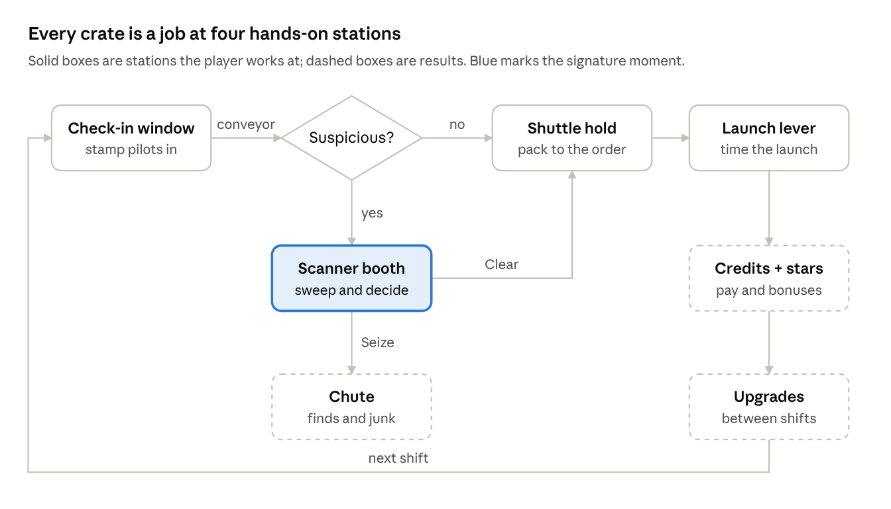
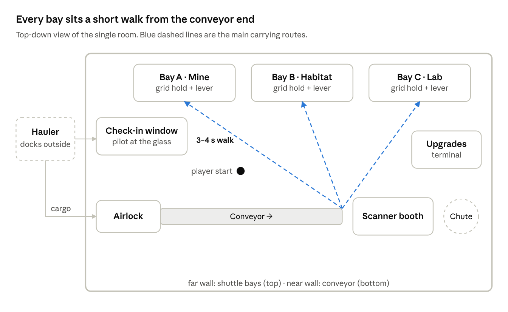
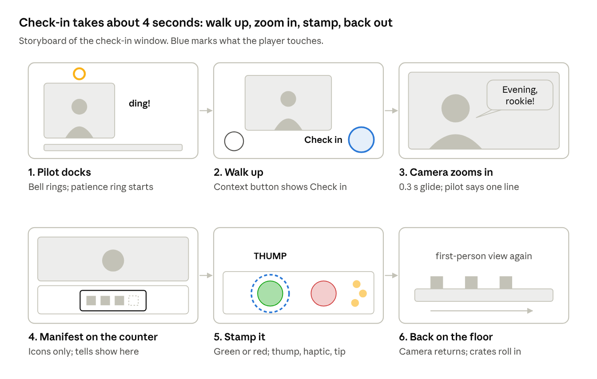
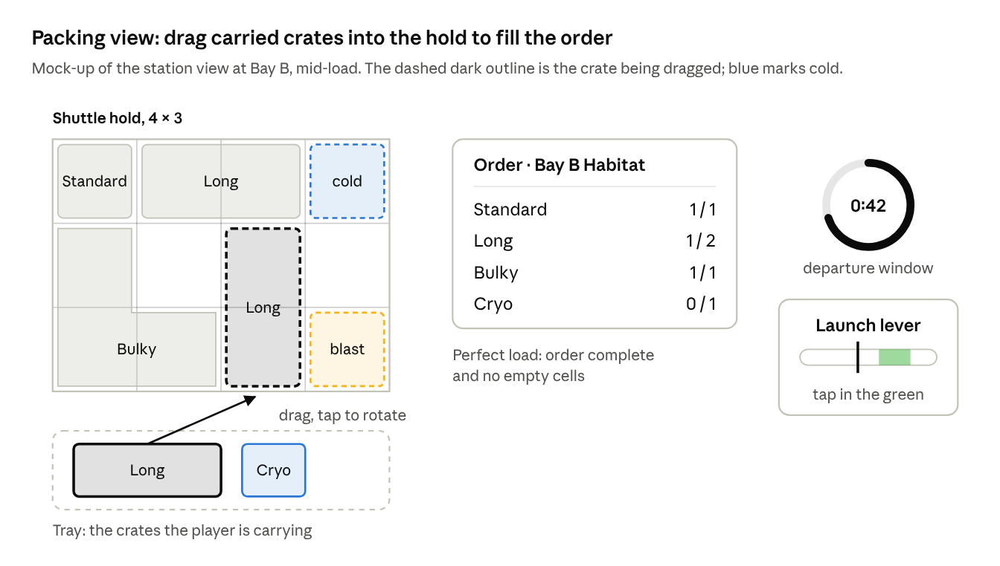
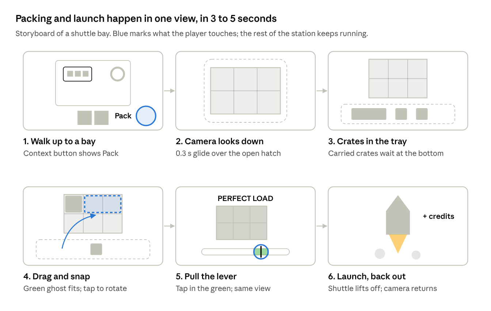
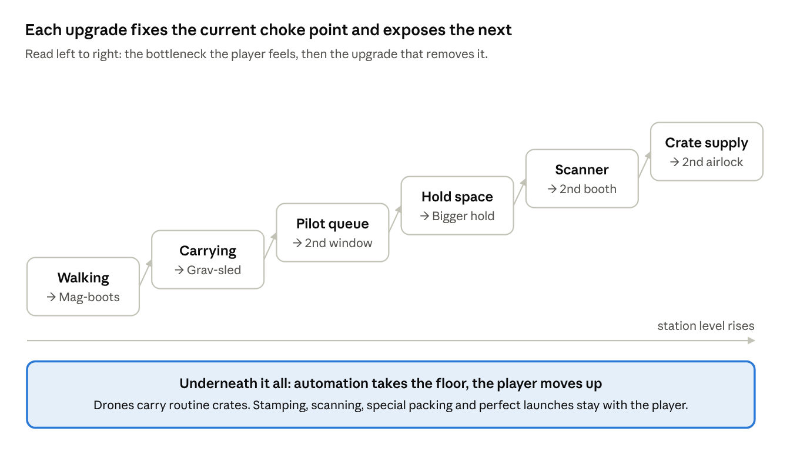

# Orbital Cargo Dispatch: Graveyard Shift — GDD v2

> Exported 5 Nov 2026 from the living GDD v2 doc (https://claude.ai/artifact/1obuAkkqLiHMKJgZjbxoqH). If they differ, the doc wins.
> The v1 GDD is archived in `docs/GDD_v1.md`. Diagrams are in `docs/gdd-images/`.

## High concept

You work the night shift on an orbital cargo station. Pilots dock at your window, you check them in, scan anything suspicious, pack their cargo into shuttles like a quick puzzle and launch each one on time. Shift by shift, a cramped dock grows into a planet-hopping logistics empire.

| | |
| --- | --- |
| Genre | First-person casual simulator (check in, inspect, pack, launch) with an idle automation layer |
| Platform | Mobile, landscape (Android and iOS) |
| Audience | Casual sim players; fans of Supermarket Simulator-style mobile sims |
| Session | 4 to 6 minute shifts; 30 to 60 minutes of content on day one |
| Comparables | Supermarket Simulator (loop, growth, the checkout feeling), Papers Please and Contraband Police (judgement at a counter), Quarantine Zone (hands-on scanning), Tetris-style packing (the perfect fit) |
| Business model | Free to play: rewarded ads first, light interstitials, IAP |

**The hook:** every crate tells you what it is at a glance, but every station asks something of your hands: a stamp, a sweep, a fit, a launch. The X-ray reveal and the "PERFECT LOAD" moment are what players remember and share.

### What changed from v1

v1 made the player carry crates to identical slots, which felt like a chore. v2 keeps first-person walking but turns each crate into a short job at a station, the way a cashier serves a customer.

| v1 | v2 | Why |
| --- | --- | --- |
| Place crates into 6 identical slots | Pack crates of different shapes into a grid hold | Placing was the dullest verb; packing is a quick, satisfying puzzle |
| Shuttles fill by crate colour | Shuttles fill to a colony order card | Each crate becomes a small choice about where it helps most |
| Launch button works only when full | Departure window, launch lever with a timing zone, early launch allowed | Adds the actual dispatch decision |
| Scanner plays an X-ray animation | Player sweeps the scanner and decides Clear or Seize | The player makes the discovery |
| No people in the loop | Check-in window with pilots who have faces and moods | Gives the cashier feeling, the humour and the pressure |
| Automation takes over the player's only job | Automation takes the floor work; the player moves up to the stations | Late game stays hands-on |
| No score | 1 to 3 star dispatch rating per shift | Gives mastery and a reason to replay |

Kept from v1: first-person walking, soft and funny failure, one new twist per chapter, and the ad rules.

## Design pillars

The v1 rule "one glance, one decision" made things easy to read, but it removed every real decision. v2 keeps the readability and puts a choice behind it.

1. **Readable at a glance, a real choice behind it.** Icons, colours and shapes only; no reading, no maths. But each station asks for a decision or a small skill.
2. **Every crate is a job with an ending.** Stamp, sweep, fit, launch. Each one finishes with a sound, a pop and a reward, like a beep at a checkout.
3. **The reveal is the star.** The scanner moment is the hook in play, marketing and sharing.
4. **Walk the floor, own the stations.** Walking connects the stations. Automation takes the floor work, never the stations.
5. **Always something growing.** Station, fleet, collection, regulars. Every session ends with visible progress.
6. **Cheap content, long life.** New stations reuse every system; new art and one twist make a chapter.

## Core loop

One shift is a stream of small jobs: check a pilot in, scan what looks wrong, pack the shuttle to its order and launch it inside its window. Between shifts, credits buy upgrades.

Walking and carrying connect the boxes; the boxes are where the game happens.

1. **Dock.** A hauler docks and its pilot comes to the window.
2. **Check in.** Stamp the manifest green (Approve) or red (Flag).
3. **Carry.** Crates roll in on the conveyor. Pick one up, or three with the grav-sled. Junk goes straight into the chute with a swipe.
4. **Inspect.** Crates with a tell or a red tag go to the scanner booth.
5. **Pack.** Drag crates into a shuttle hold whose order card wants them.
6. **Launch.** Pull the lever inside the departure window and hit the green zone.
7. **Upgrade.** Spend credits between shifts.

## Room layout and walking routes

The room is tuned by walking time, not by looks: every trip from the conveyor end to a bay should take 3 to 4 seconds at base walk speed.

The check-in window sits right above the airlock, so stamping a pilot and grabbing their first crate is one short step. The scanner booth and chute sit at the conveyor end, where suspicious crates and junk first show up.

- **Conveyor** enters through the airlock on the left wall and runs along the near wall.
- **Three bays** line the far wall. Each has a grid hold, an order card, a departure ring and a launch lever.
- **Upgrade terminal** on the right wall, by the door.
- As the station expands, add a second airlock and bays on the side walls, but keep every trip under 4 seconds by giving the player faster movement first.

## The four stations

Every station uses the same pattern: walk up, tap, and the camera eases into a close **station view** (about 0.3 s). Inside it, the player uses direct touch (tap, drag, swipe) instead of first-person aiming. When the job is done, the camera returns to first person by itself; moving the joystick or swiping down leaves early. This is how Supermarket Simulator handles its checkout, and it removes the fiddliest part of first-person control on mobile.

### 1. Check-in window (the cashier)

A hauler docks outside the glass and its pilot appears at the window: a face, a mood and one radio line. They slide over a **manifest card** made of icons (for example, 3 standard, 1 cryo).

- **Stamp green (Approve):** their crates roll onto the conveyor.
- **Stamp red (Flag):** their crates roll in with a red tag and must go through the scanner.
- **Patience ring** above each pilot. A fast check-in earns a tip and a happy line. A slow one gets a honk and a grumble, never a fail.
- **Tells** are visual: a sweating pilot, a smudged manifest icon, Vex's grin, a crate rattling behind the glass.
- Pilots queue like customers at a till. This is the main source of pressure early on.

**How a check-in plays, beat by beat:**

There is no separate screen. The camera moves to a fixed view of the counter, and the only 2D UI is the speech bubble (plus a stamp hint in the tutorial). The manifest card and the stamps are objects on the counter, so it feels as physical as scanning items at a till. When the stamp lands, the camera returns by itself.

### 2. Scanner booth (the discovery)

The player sets a crate in the booth and **sweeps a finger across it**. The X-ray shows only under the finger, like a torch in the dark. Each crate carries a **content label** icon (fruit, tools, pet, books): what that one crate claims to hold. The pilot's manifest card covers the whole delivery; the content label covers a single crate.

- The X-ray silhouette **matches** the label → tap **Clear** (green) and carry the crate on.
- It **doesn't match** → tap **Seize** (red). The crate drops through the chute, pays a bonus and adds the item to the collection book.
- Funny edge cases come later: "Label: pet. X-ray: tentacles." Some odd items are legal.
- Costs time (2 to 3 s sweep plus the walk), so the player has to triage which tells are worth scanning while orders tick.

### 3. Shuttle hold (the packing puzzle)

Each bay holds a shuttle with an **open grid hold**. In the station view, crates the player is carrying sit in a tray; the player drags them onto the grid, and taps a crate to rotate it.

- **Shapes:** most crates take 1 cell; long crates take 2; L-shaped crates take 3.
- **Special cells:** blue cold cells for cryo crates; a striped blast cell for volatile crates.
- **Order card** on the bay door shows which crates this shuttle wants.
- **Perfect load:** order complete and no gaps → big "PERFECT LOAD" banner and a bonus.
- Starting hold: 2 × 3 cells, growing to 4 × 4 through upgrades.

The player can read everything from the station view: what the order still needs, where the special cells are, how long the window has left, and where to tap on the lever.

**How a pack plays, beat by beat:**

There is no separate screen: the camera looks down through the shuttle's open hatch at a real 3D grid, and the tray of carried crates is the only overlay. The launch lever sits beside the hold in the same view, so the player can pack and launch without leaving. The camera returns to first person when the tray is empty or the shuttle launches.

The game doesn't pause while the player packs: pilots keep queuing and cryo timers keep ticking. Packing should take 3 to 5 seconds, which is why holds start at 2 × 3 and only grow as the player gets faster.

### 4. Launch lever (the payoff)

Each shuttle has a **departure ring** on its bay door, a window of roughly 60 to 90 seconds that starts when its order arrives.

- Pull the lever any time to launch early. The shuttle pays for what's loaded; the order bonus only comes with a complete order.
- A fuel needle sweeps once; tap in the green zone for a **Perfect launch** (bonus, bigger blast, camera shake and haptics).
- If the ring runs out, the shuttle leaves anyway with whatever is loaded. Nothing fails.
- The real decision: "launch 4 of 6 now, or wait for the cryo crate before the window closes?"

## Crates, orders and interruptions

Every crate type has its own colour **and** its own icon, so the game also reads for colour-blind players. Cold cells and blast cells in the hold show the same icons as the crates that need them.

| Crate | Look and icon | Size in hold | Twist | Unlocks |
| --- | --- | --- | --- | --- |
| Standard | Grey-blue steel, square icon | 1 cell | None. The baseline. | Start |
| Long | Grey-blue, double length, bar icon | 2 cells | Rotate it to fit. | Shift 2 |
| Cryo | White casing, cyan lights, snowflake icon | 1 cell, on a cold cell | Ring timer (start at 45 s); pays less once it turns red. | Shift 2 |
| Junk | Rusty, red tape, beeping, cross icon | Never packed | Swipe-throw into the chute. | Shift 3 |
| Bulky | Steel, L-shaped, corner icon | 3 cells | The shape that makes packing a puzzle. | Shift 4 |
| Volatile | Yellow, black chevrons, flame icon | 1 cell, on the blast cell | Jostle meter while carried: sprinting or sharp turns fill it; if it overflows, a comic pop and the crate is lost. | Shift 5 |
| Suspicious | Any type that shakes, sparks or drips glowing goo, or carries a red check-in tag | Goes to the scanner first | See the scanner booth. | Shift 2 (scripted) |

### Colony orders

- Every shuttle shows an **order card**: a short row of crate icons (for example, 2 standard, 1 cryo, 1 long).
- A crate can go into any shuttle whose card wants it. When two bays want the same crate, the player chooses which one, usually the shuttle whose window closes first.
- Bays are named destinations on the colony (Mine, Habitat, Lab) for flavour and radio lines. They no longer have fixed crate types.
- Wrong crates can't be placed: the ghost turns red. This keeps mistakes about choices, not misclicks.

### Interruptions

One per shift early on, up to two later. Each takes a few seconds and breaks the rhythm so no two shifts feel the same.

| Interruption | What happens | Player action |
| --- | --- | --- |
| Conveyor jam | Crates pile up with a grinding noise | Tap the jam three times (a kick) |
| Escaped critter | A crate that was wrongly cleared hatches; a small alien runs around | Chase and tap to catch it |
| Boss rush order | A gold order card with double pay and a short window | Decide whether to drop everything for it |
| Blackout | Lights fail for about 10 s; suspicious goo glows brighter in the dark | Keep working; tells are easier to spot |
| Vex docks | The smuggler arrives at the window with a grin and a story | See Characters |

Failure stays soft. A spoiled cryo crate, a missed window or a wrong call pays less or costs a small fine. Nothing ends a shift early.

## Controls and HUD

The player walks in first person between stations and uses direct touch inside them. First-person aiming is only ever needed to pick a crate up.

| Context | Control |
| --- | --- |
| Move | Floating thumbstick, left half of the screen |
| Look | Drag anywhere on the right half |
| Pick up | Context button (bottom right). A generous aim cone with a sticky highlight, so the player never has to aim precisely |
| Enter a station | Context button when the station is highlighted; the camera eases into station view |
| Inside a station | Tap to stamp, drag to sweep or place, tap a crate to rotate it, tap the lever zone to launch |
| Leave a station | Automatic when the job is done; move the thumbstick or swipe down to leave early |
| Throw junk | Quick upward swipe while holding junk; the arc into the chute is assisted |

**HUD top bar:** credits, shift clock, dispatch rating meter, pause.

**In the world, not on the HUD:** order cards and departure rings on the bay doors, patience rings above pilots, cryo rings on crates, the jostle meter on volatile crates. The player reads the station, not the screen edge.

**Optional rewarded button** (for example, "Free drone") next to the context button, hidden while carrying.

## Shift structure and pressure

A shift lasts 4 to 6 minutes, and the pressure comes from three soft clocks the player can see in the world. None of them can end the shift.

| Clock | Where it shows | What it costs when it runs out |
| --- | --- | --- |
| Pilot patience | Ring above the pilot at the window | No tip, a grumpy line, a small rating dip |
| Departure window | Ring on the bay door | The shuttle leaves with what's loaded; no order bonus |
| Cryo timer | Ring on the crate | The crate pays less |

### Dispatch rating

One meter on the HUD rises with good work (fast check-ins, complete orders, perfect loads, perfect launches, correct seizures) and dips with mistakes. At shift end it turns into 1 to 3 stars.

- Stars gate milestone chests and count towards station level.
- Players can replay any shift for more stars. This is the mastery loop v1 was missing.

### The first 10 minutes

| Time | What happens | Teaches |
| --- | --- | --- |
| 0:00–1:00 | Rook docks at the window and chats. Stamp him in. One standard crate rolls in; carry it to Bay A, drag it into the grid, pull the lever, hit the green zone. The shuttle blasts off and cash rains out. | Move, stamp, carry, pack, launch |
| 1:00–3:00 | Two more pilots with small orders. First upgrade prompt: mag-boots (walk speed). | The earn-and-upgrade rhythm |
| 3:00–5:00 | Cryo crates and cold cells appear. Departure rings switch on. | Prioritising under light pressure |
| 5:00–7:00 | Vex docks with a big grin; one of his crates shakes. Rook: "Don't trust that smile. Scan it." The sweep shows an alien egg; the label says fruit. Seize → collection book. | The discovery hook |
| 7:00–10:00 | Shift ends. Star rating, summary, first 2x rewarded-ad offer, grav-sled teased behind a lock. Junk and the chute arrive next shift. | Session end, monetisation, reason to return |

Bulky crates arrive around shift 4 and volatile crates around shift 5, so each shift adds one new thing.

## Progression

Upgrades are sequenced so each one removes the bottleneck the player is feeling right now, which is what makes buying it feel good.

If an upgrade doesn't change what slows the player down, it isn't on the ladder yet.

### Upgrades

| Upgrade | What it does | Bottleneck it removes |
| --- | --- | --- |
| Mag-boots | Faster walking | Walking |
| Grav-sled | Carry 3 crates | Carrying |
| Cargo exosuit | Carry 5; the jostle meter fills half as fast | Carrying, volatile crates |
| Second check-in window | Serve two pilots at once; regulars can self-stamp | Pilot queue |
| Bigger holds | 2 × 3 → 3 × 3 → 4 × 3 → 4 × 4 | Hold space |
| Booth upgrades | Faster sweep, a second booth, an auto-flag drone that tags suspicious crates | Scanner |
| Second airlock | More crates per minute | Crate supply |
| Loader drones | Carry standard crates on their own | Automation |
| Auto-launch | Launches complete shuttles at the end of their window, without the timing bonus | Automation |

### Automation rule

Automation takes the floor; the player moves up. Drones handle the walking and the routine crates. They never stamp, scan, pack special crates or hit a perfect launch, so the hands-on stations stay with the player all game. The first loader drone unlocks around shift 5, so offline earnings start on day one.

**Station level:** XP from every launch and every star. Levels unlock crate types, upgrades and expansions.

### Chapters

Each new station reuses every system, adds new art and one twist. Each twist stretches a different station, so chapters don't repeat the same idea.

| Station | Theme | New twist | Station it stretches |
| --- | --- | --- | --- |
| 1. Ironfall | Industrial mining colony | The base set | All four |
| 2. Glacia | Frozen moon | Two-stop shuttles: crates for the first stop must go in the front rows | Shuttle hold |
| 3. Verdant | Jungle world | Live animal cargo: some are legal pets, some are banned species | Scanner |
| 4. Nimbus | Gas giant | Storm fronts: all bays share one launch window while a storm passes | Launch lever |
| 5. The Bazaar | Alien trade hub | Alien VIP pilots with requests and big tips | Check-in window |

## Meta and retention

The collection book and the regular pilots are the two reasons to come back; live ops add variety on top.

### Characters

The night-shift setting carries the tone: cozy industrial sci-fi with a slightly spooky edge. There are flickering lights, eerie radio, and things that hatch.

| Character | Role | How the player meets them |
| --- | --- | --- |
| The Boss | Grumpy station manager | Radio only. Rush orders, budget complaints, shift-end verdicts |
| Rook | Friendly veteran pilot | Tutorial voice; a regular at the window |
| Vex | Charming smuggler and recurring rival | Docks a few times per station with a new trick: decoy crates, a fake stamp, a crate that only shakes in the dark. Catching him moves a "Catch Vex" track forward. No bribes. |
| Regulars | 4 to 6 pilots per station, each with a quirk | Their lines change as you serve them well, so they feel like your customers |

### Collection book

- Every seized item is logged. Sets are themed per station (Alien Wildlife, Black Market Tech, Stolen Art, Weird Food), and completing a set pays a reward.
- Items come in common, rare and legendary versions, so the reveal has a gacha-like thrill.
- Duplicates turn into scanner upgrade parts, so no find is wasted.

### Live ops

- **Daily:** 7-day login cycle, three simple missions, one VIP shipment, offline earnings.
- **Weekly events:** Meteor storm (bonus junk), Vex week (double suspicious cargo and a Vex boss shift), Holiday cargo (gift crates with cosmetics), Blackout night (lights out, glowing tells).
- **Story:** short radio exchanges between shifts and a small arc per station.

## Economy and monetisation

Two currencies, and ads placed only where the player has stopped moving. Prices are left to the market team.

- **Credits (soft):** earned from launches, tips, order and perfect bonuses, seizures. Spent on upgrades, expansion and drones.
- **Quantum Cores (hard):** from missions, events, collection sets and the shop. Spent on premium drones, cosmetics, skips and rare equipment.

| Rewarded ad | Where | What it gives |
| --- | --- | --- |
| 2x payout | Shift summary | Doubles the shift's credits |
| 2x offline earnings | Return screen | Doubles idle income |
| Free helper drone | In shift, next to the context button | A drone carries crates for 3 minutes |
| Extra time | On a bay door when its ring is red | +15 s on one departure window |
| Lucky Scan | Scanner booth | Outlines the hidden item before the sweep |
| Free chest | Daily | A small chest |

The v1 "instant restock" ad is cut. If the conveyor runs dry, that's a pacing bug to fix, not something to sell.

**Interstitials:** only between shifts, never while carrying or in a station view, at most one every two shifts, none in the first three sessions.

**IAP:** remove forced ads, starter pack, VIP subscription, season pass, core packs and cosmetics. Cosmetics are things the player sees in first person: station decor, shuttle liveries, crate skins, stamp designs, scanner effects.
